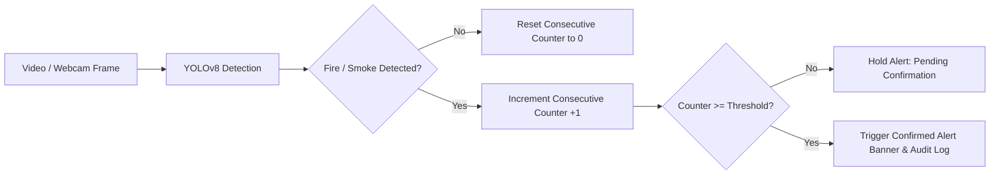

# AI-Based Real-Time Fire and Smoke Detection Using Computer Vision

A complete, production-ready computer vision application built with **Python**, **Ultralytics YOLOv8**, **OpenCV**, and **Streamlit**, featuring **real-time browser webcam streaming via WebRTC** for seamless cloud deployments (e.g. Streamlit Community Cloud).

The system provides real-time detection of fire and smoke from static images, recorded video files, and live webcam feeds, equipped with **temporal consecutive-frame confirmation** to eliminate transient false alarms.

---

## 🌟 Key Features

1. **🌐 Real-Time WebRTC Live Browser Webcam Streaming**:
   - Streams client webcam frames directly from any web browser using `streamlit-webrtc` and `aiortc`/`PyAV`.
   - Solves the server-side limitation where `cv2.VideoCapture(0)` cannot access remote client webcams on Streamlit Community Cloud or Docker containers.
   - Real-time overlay of high-contrast bounding boxes, class labels ("Fire", "Smoke"), confidence scores, alert banners, and HUD telemetry.
   - Built-in Start/Stop controls with automatic STUN server NAT traversal (`stun.l.google.com:19302`).

2. **💻 Local Continuous Webcam Mode (OpenCV)**:
   - Preserved for local execution and debugging directly attached USB or built-in cameras.
   - Hardware-accelerated DirectShow (`cv2.CAP_DSHOW`) on Windows for instant camera capture.
   - Device index selector with built-in hardware access diagnostics.

3. **📸 Browser Snapshot Mode (`st.camera_input`)**:
   - Fallback mode utilizing the browser's native camera API.
   - Immediate detection analysis and alert logging for low-bandwidth or restrictive firewall environments.

4. **📷 Static Image Detection**:
   - Upload any image (`.jpg`, `.jpeg`, `.png`, `.webp`) or select from built-in sample benchmarks.
   - Side-by-side original vs. annotated view with bounding boxes and coordinates table.
   - Granular bounding box telemetry coordinates and inference latency metrics.

5. **🎥 Frame-by-Frame Video Detection**:
   - Upload video files (`.mp4`, `.avi`, `.mov`, `.mkv`) or run the included sample fire video.
   - Real-time visual progress preview with adjustable frame stride for accelerated inference.
   - Download the annotated video with bounding boxes and labels rendered.

6. **🛡️ Consecutive-Frame Confirmation (False-Alarm Mitigation)**:
   - Prevents false alarms caused by sunlight reflections, yellow/orange jackets, vehicle headlights, or steam.
   - Configurable confirmation threshold ($K$ consecutive frames) and cooldown periods.

7. **🚨 Visual Emergency Alerts & Telemetry**:
   - High-visibility pulsing red alert banner for confirmed **FIRE**.
   - Amber alert banner for confirmed **SMOKE**.
   - Combined multi-hazard alert banner when both hazards are detected simultaneously.

8. **📊 Audit Trail & CSV Export**:
   - Timestamped log of all confirmed alert incidents with peak confidence scores.
   - One-click export to CSV for safety audit reporting.

---

## 🗂️ Project Structure

```text
fire-smoke-detection-webrtc/
├── app.py                  # Streamlit dashboard UI with multi-tab navigation
├── detector.py             # Ultralytics YOLO inference wrapper & OpenCV annotator
├── webrtc_processor.py     # WebRTC video frame processor & STUN configuration
├── alert_manager.py        # Temporal confirmation state machine & incident logger
├── test_system.py          # 10 automated unit & integration tests
├── requirements.txt        # Python dependency manifest
├── README.md               # Documentation & deployment guide
├── models/
│   └── fire_smoke_yolov8n.pt  # Fine-tuned YOLOv8 fire & smoke weights (~6.2 MB)
└── samples/                # Sample media assets for immediate 1-click testing
    ├── sample_fire_1.jpg
    ├── sample_smoke_1.jpg
    ├── sample_fire_smoke.jpg
    ├── dfire_examples.png
    └── sample_fire_video.mp4
```

---

## 📦 Model Information & Class Verification

This project uses an Ultralytics YOLOv8 Nano model fine-tuned on the **D-Fire** dataset (`rabahdev/fire-smoke-yolov8n`):

- **Model Architecture:** YOLOv8n (Nano)
- **Supported Classes:**
  - `0`: **smoke**
  - `1`: **fire**
- **Model Size:** ~6.2 MB (fast on CPU, ultra-fast on GPU)
- **Automatic Class Validation:** `detector.py` automatically checks the model's class dictionary upon loading. If an unrelated model is supplied (e.g. standard COCO model detecting cars and persons), it raises an `IncompatibleModelError` to prevent incorrect alerts.

### Using Custom Trained Weights
If you have trained your own YOLO model for fire and smoke:
1. Place your `.pt` file inside the `models/` directory (e.g. `models/my_custom_model.pt`).
2. In the Streamlit sidebar, enter your model path in the **Model Weights Path** input field.
3. Click **🔄 Reload Model**.

---

## 🚀 Getting Started Locally

### 1. Prerequisites
- Python 3.10, 3.11, 3.12, 3.13, or 3.14.
- Windows 10/11, macOS, or Linux.

### 2. Installation
Open PowerShell or your command terminal in the project directory:

```bash
# Optional: Create and activate a virtual environment
python -m venv venv
.\venv\Scripts\activate      # On Windows
# source venv/bin/activate   # On Linux/macOS

# Install dependencies
pip install -r requirements.txt
```

### 3. Run Automated Tests
Verify all components, detector inference, camera utilities, and WebRTC processors:

```bash
python -m unittest test_system.py -v
```

Expected output:
```text
test_01_model_classes_verified ... ok
test_02_image_detection ... ok
test_03_temporal_smoothing_false_alarm_rejection ... ok
test_04_alert_history_logging_and_clearing ... ok
test_05_video_processing ... ok
test_06_camera_access_utility ... ok
test_07_missing_custom_model_error ... ok
test_08_webrtc_video_processor_frame_handling ... ok
test_09_webrtc_consecutive_alert_generation ... ok
test_10_webrtc_processor_safe_fallback ... ok

Ran 10 tests in 3.5s
OK
```

### 4. Launch the Dashboard
Run the Streamlit application:

```bash
streamlit run app.py
```

The application will automatically launch in your default web browser at `http://localhost:8501`.

---

## ☁️ Streamlit Community Cloud Deployment

When deploying to Streamlit Community Cloud:

1. Push this repository to GitHub.
2. In Streamlit Community Cloud:
   - Select your repository and branch.
   - Set **Main file path** to `app.py`.
   - Click **Deploy**.
3. **Webcam Access on Cloud:**
   - On the deployed application, navigate to the **Live Webcam** tab.
   - Select **🌐 WebRTC Live Browser Streaming (Cloud & Local)** (selected by default).
   - Click **START** on the WebRTC widget.
   - When your browser prompts for camera access, click **Allow**.
   - Note: Modern web browsers require an **HTTPS** connection to access the webcam, which Streamlit Community Cloud provides automatically.

---

## 🛠️ How Consecutive-Frame Confirmation Works

In real-world computer vision, visual noise (such as sudden glare, cigarette smoke, or brightly colored clothing) can trigger momentary single-frame false positives.



- When fire is detected in a frame, `fire_consecutive` increments.
- If the hazard persists for $K$ consecutive frames (default: 3 frames), the alert status transitions to **CONFIRMED ACTIVE**.
- If a frame drops the detection, the counter immediately resets to 0.
- This temporal smoothing algorithm prevents false alarms from transient artifacts.

---

## 🔧 Webcam Modes & Troubleshooting

| Mode | Best For | Architecture | Notes |
| :--- | :--- | :--- | :--- |
| **🌐 WebRTC Live Streaming** | Streamlit Cloud, Remote Users, Web Browsers | Browser MediaStream -> WebRTC PeerConnection -> YOLO Inference -> Return Annotated Frame | Requires browser camera permission and HTTPS. Traverses NAT using Google STUN. |
| **💻 Local OpenCV Stream** | Local Desktop Development | Server `cv2.VideoCapture` -> OpenCV DirectShow -> Frame Loop | Only works when the application runs directly on the local machine with an attached camera. |
| **📸 Browser Snapshot Mode** | Low bandwidth, Restrictive corporate firewalls | Native `st.camera_input` HTTP upload | Single photo capture and evaluation. |

---

## 📄 License
This project is open-source and intended for educational and safety monitoring purposes.
